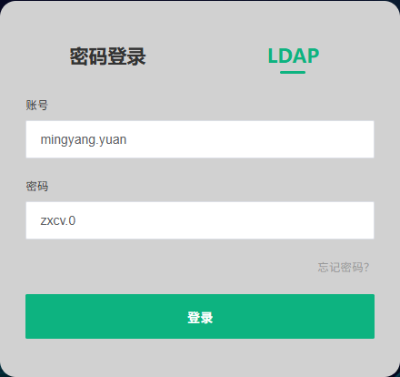

# SBOM
网址：<https://cve.simcom.com/>
账号：`mingyang.yuan`
密码：电脑登录密码
登录方式，LDAP
令牌：`jFBFRXCA1UK9RMjFICuhuft2MgKaQ8HaaGDaVXrvCyepEIyCEpLx3hHFMD658xBY`
扫描命令：
```
java -Dfile.encoding="UTF-8" -Dsun.jnu.encoding="UTF-8" -jar ./scanner-V5.3.0.build3.0.A.jar  --platform.url=https://cve.simcom.com/ --platform.token=jFBFRXCA1UK9RMjFICuhuft2MgKaQ8HaaGDaVXrvCyepEIyCEpLx3hHFMD658xBY --scanner.size.limit.check=false --scanner.tools.excluded=DETECTOR --scanner.detector.size.limit=4096 --scanner.project.name=RK --scanner.project.version.name=001  --scanner.source.path=/home/yuanmingyang/workspace/SBOM/RK_openSourceCode/RK_A14
```



# IKUUU
网址：<https://ikuuu.fyi>
邮箱：`find@ikuuu.pro`
账号：`735575835@qq.com`
密码：`iksecret`

# 展锐

展锐网址资料
资料：https://unisupport.unisoc.com/index 
user: chendegang1@sunseaaiot.com
password:Cdg.8500

展锐CQ
[http://spcss.unisoc.com:2008/cqweb/](http://spcss.unisoc.com:2008/cqweb/) 
user:sunsea
password:QOu-SPEz-&AY-*06bfhm

展锐ftp
ftp://ftp.unisoc.com
user:sunsea
password:BjdB2BNb

# 高通

高通网址
services：https://createpoint.qti.qualcomm.com
Account(Email): yuanmingyang@sunseaaiot.com
Login Password: QCsecret42808891
**degang.chen@sim.com  密码Sim.895****0**

# MTK

online
http://online.mediatek.com
degang.chen@simcom.com
Cdg.0930
